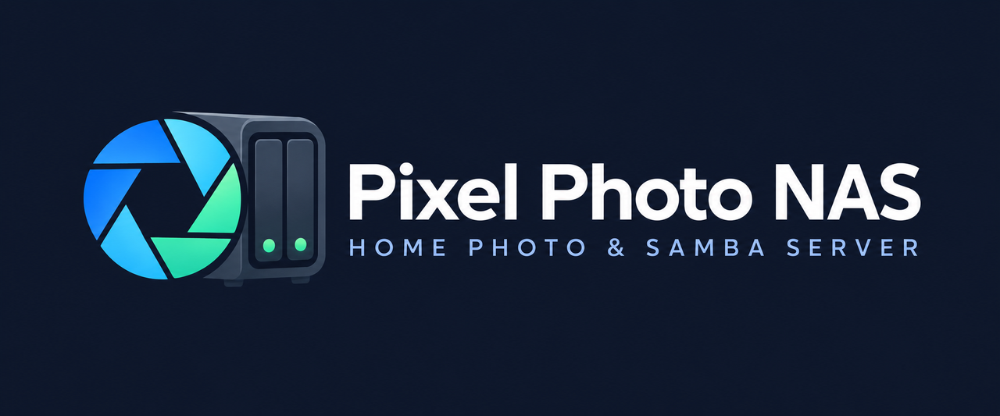
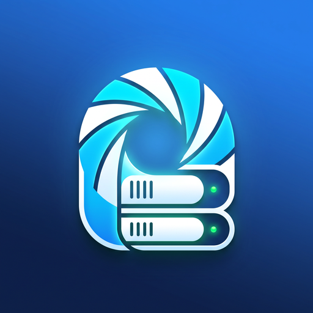

<div align="center">
  
  <br /><br />
  
  <h1>Pixel Photo NAS + Dedicated Household Samba Android App</h1>
</div>

Turn any **Google Pixel 1 through Pixel 5** (or Linux/Termux box) into a self-hosted 24/7 home Wi-Fi **Photo & Video NAS** with a **dedicated standalone Household Android App (`com.pixelnas.household`)** that connects **directly over Samba / SMB2 / SMB3 file shares (`\\<nas>\PixelNAS`)**:

1. **APK #1 — Closet NAS Server (`android-app/` → `PixelPhotoNAS-vX.Y.Z-Pixel1to5-Signed.apk`)**
   - Runs natively on **Google Pixel 1 through Pixel 5** (or standalone via Python `server/`).
   - Serves **Samba / SMB2 File Share (`\\<ip>\PixelNAS`, `\\<ip>\Incoming`, `\\<ip>\Output`)**, **Browser NAS Web UI (`:8080`)**, **WebDAV (`/webdav/`)**, **FTP (`:2121`)**, and local Android folder watching.
   - Automatically converts `> 16.0 MP` photos to `≤ 16.0 MP` Storage Saver JPEGs and `4K` videos to `1080p` MP4s while preserving 100% EXIF dates/GPS, isolating corrupted uploads into `.nomedia`-protected `PixelNAS/Quarantine/`, notifying Android `MediaStore` for **Google Photos Unlimited Backup**, and deleting verified full-resolution staging files.

2. **APK #2 — Separate Household Android App (`household-app/` → `PixelPhotoNAS-Household-vX.Y.Z-SambaClient-Signed.apk`)**
   - Standalone lightweight Android app (`com.pixelnas.household`) built specifically for **every household member's daily Android phone**.
   - Connects **directly to your NAS over native Samba (`SMB2 / SMB3`, `com.hierynomus:smbj`)** — works seamlessly with **standard Samba shares on port `445`** (`smbd`, Synology, TrueNAS, OpenMediaVault, Windows File Sharing) **AND unrooted Pixel Photo NAS shares on port `4445`**.
   - Includes **1-Tap Wi-Fi NAS Discovery**, **Guest & NTLMv2 Username/Password/Workgroup Auth**, **Per-Member & Per-Profile Routing** (`StorageSaver`, `Original`, `Family`, `<MemberName>`), **Atomic `.part` → Final Rename + EXIF Timestamp Preservation**, **Live Samba Share Browser**, **Optional Automatic Wi-Fi Camera Roll Sync**, **Android System Share Sheet (`Send to NAS (Samba)`)**, and **Native Android Home Screen Samba Upload Widget**.

---

## Automated 2-APK Compilation & Base-10 Rollover Versioning on Every Merge

GitHub Actions (`.github/workflows/build-apk.yml` + `server/versioning.py`) runs full Python + live Android-to-Samba integration tests, signs **both** APKs with the persistent PKCS#12 release keystore (`android-app/keystore/pixelnas-release.p12`), and publishes a tagged **GitHub Release** on every merge to `main`:

- **First merge to `main`**: **`v1.0.0`** (`versionCode = 1`)
- **Patch increments (`+0.0.1`)**: `v1.0.0` → `v1.0.1` → … → `v1.0.9` → **`v1.1.0`**
- **Minor column rollover**: `v1.1.0` → … → `v1.8.9` → `v1.9.0` → … → `v1.9.9` → **`v2.0.0`**

---

## Supported Pixel NAS Devices & Google Photos Unlimited Tiers

| Device Family | Codenames | Android API | Google Photos Entitlement | Recommended Default Mode |
|---|---|---|---|---|
| **Pixel / Pixel XL (2016)** | `sailfish`, `marlin` | Android 8.0–10 (API 26–29) | **Unlimited Original Quality** | **Pass-Through (`Saver OFF`)** *(or use `Incoming\StorageSaver\` to save local flash space)* |
| **Pixel 2 / 2 XL** | `walleye`, `taimen` | Android 8.0–11 (API 26–30) | **Unlimited Storage Saver** | **Storage Saver ON** |
| **Pixel 3 / 3 XL / 3a / 3a XL** | `blueline`, `crosshatch`, `sargo`, `bonito` | Android 9–12 (API 28–31) | **Unlimited Storage Saver** | **Storage Saver ON** |
| **Pixel 4 / 4 XL / 4a** | `flame`, `coral`, `sunfish` | Android 10–13 (API 29–33) | **Unlimited Storage Saver** | **Storage Saver ON** |
| **Pixel 4a (5G) / Pixel 5** | `bramble`, `redfin` | Android 11–14 (API 30–34) | **Unlimited Storage Saver** | **Storage Saver ON** *(Ideal 24/7 closet NAS hardware: 6–8 GB RAM, 128 GB UFS, cool 765G)* |

---

## Smart Household & Closet NAS Capabilities

- **Instant QR & Deep-Link Pairing (`pixelnas://pair?...`)**: Scan the pairing QR on the Closet Pixel NAS or Web UI (or paste the `pixelnas://pair` link) to auto-configure Samba host, port (`445`/`4445`), share name, workgroup, and auth in 1 tap.
- **Google Takeout `.zip` Direct Drop & Auto-Extractor**: Drop `takeout-*.zip` archives directly into `Incoming` — stream-extracts photos, videos, and `.json` GPS/date sidecars safely (zip-slip guarded), converts to Storage Saver, and removes the `.zip`.
- **Pixel Motion Photo (`MVIMG` / `.MP.jpg`) & Wide-Gamut `sRGB` Preservation**: Preserves embedded MP4 motion clips inside resized `≤ 16 MP` JPEGs and normalizes Display P3 / HEIC / AVIF wide-gamut ICC profiles to standard `sRGB`.
- **Smart Camera-Roll Sync Rules + "Free Up Phone Space"**: Configure **Charging-Only** and **Trusted Home Subnet** rules in `PixelPhotoNAS-Household.apk`, and move already-synced local Camera Roll items safely to Android's 30-day Trash (`MediaStore.createTrashRequest`).
- **Interactive Remote Samba Preview, Save-to-Gallery & Share**: Preview photos directly over SMB2 inside the Household App's **Samba Share** browser, save remote NAS files to your phone's Gallery/Downloads, or share them via Android Share Sheet.
- **Per-Member Storage Analytics & Optional `YYYY/YYYY-MM` Auto-Sorting**: View per-member/per-profile uploaded counts and GB saved, plus optional capture-date chronological folder sorting.
- **Perceptual Burst & Near-Duplicate Guard (`64-bit dHash`)**: Optional `64-bit dHash` Hamming-distance filter alongside `SHA-256` to catch re-encoded WhatsApp copies and near-identical camera bursts.
- **Built-In `PublicShare` Privacy Scrubber Profile**: Uploads to `/Incoming/PublicShare/` automatically scrub GPS coordinates and camera serials while keeping capture timestamps intact.
- **24/7 Health Guard & Push Webhooks (`ntfy.sh` / Discord / Slack)**: Monitors AC power, warm trickle battery swell conditions, quarantined files, and low disk space with instant webhook push alerts.
- **Streaming `.zip` Album Export, Backup/Restore JSON & Quiet-Hours Video Schedule**: Download `Output` albums as streaming `.zip` archives, export/import NAS settings + deduplication ledgers as JSON, and optionally defer heavy 4K video transcodes to overnight Quiet Hours.

---

## Quick Start

### 1. Closet Pixel 1–5 NAS Server (`PixelPhotoNAS-vX.Y.Z-Pixel1to5-Signed.apk`)
1. Install **`PixelPhotoNAS-v1.0.0-Pixel1to5-Signed.apk`** on your closet Pixel 1–5.
2. Grant **All Files Access** and confirm **NAS Daemon Online** (exposes `\\<pixel-ip>\PixelNAS` on `:4445` plus Web UI `:8080`, WebDAV, and FTP `:2121`).
3. In **Google Photos → Collections → On this device**, enable **Backup** for `PixelNAS` (and any custom output folders like `Family`).

### 2. Family Phones (`PixelPhotoNAS-Household-vX.Y.Z-SambaClient-Signed.apk`)
1. Install **`PixelPhotoNAS-Household-v1.0.0-SambaClient-Signed.apk`** on every household Android phone.
2. Open **Samba Setup → Scan Wi-Fi for Samba NAS** (or enter your NAS IP / Samba share `\\192.168.1.x\PixelNAS`).
3. Pick your member name (e.g. `Mom`, `Dad`, `Alex`), optionally turn on **Automatic Wi-Fi Camera Roll Sync**, and tap **Pin Samba Upload Widget to Home Screen**!

### 3. Standalone Python / Termux NAS + Samba Server (`server/`)
```bash
pip install -r requirements.txt
python3 -m server.main
```
Run the automated test suite (including live SMB2/NTLMv2 Samba transfers & Storage Saver conversion):
```bash
pytest -v
```
