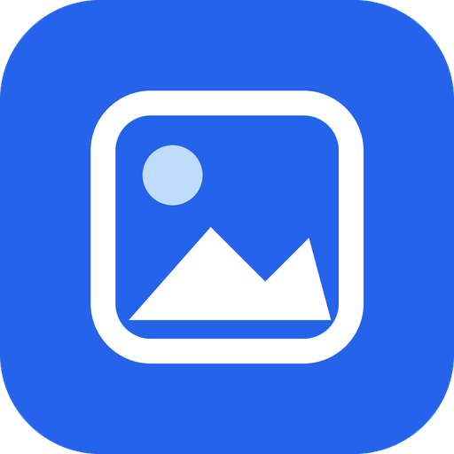

<div align="center">
  
  <h1>Photo Convert Android</h1>
  <p>A clean, modular, privacy-first batch photo converter, optimizer, PDF scan builder &amp; background folder watcher for Android and local Web Studio.</p>
</div>

---

## Highlights & Pro Capabilities

- **Focused 4-Tab Navigation (`Convert`, `PDF & Watch`, `Presets`, `History`)** — Clean Material 3 Jetpack Compose UI on Android paired with an identical lightweight Web Studio (`webui/`), keeping advanced tools tucked inside progressive-disclosure cards.
- **Interactive Split-Screen Before/After Loupe (`100%–400%`)** — Drag a live before/after divider with 1×–4× pixel zoom and instant byte-savings readout before committing to a batch.
- **Exact Target File-Size Mode (`Fit Under X KB / MB`)** — Binary-searches encoder quality and progressively steps down dimensions only if needed to guarantee strict portal upload caps (`≤ 200 KB`, `≤ 500 KB`, `≤ 1 MB`, `≤ 2 MB`, or custom).
- **Batch Photo-to-PDF & Scan Sheet Exporter** — Pack multiple photos into a compact `A4`, `US Letter`, or `Fit Photo` multi-page PDF with configurable margins and a crisp grayscale high-contrast document scan filter.
- **Background Watched-Folder Auto-Converter** — Android `WorkManager` + Storage Access Framework (`OpenDocumentTree`) and a companion server watcher daemon automatically convert newly dropped photos using your active settings.
- **RAW (`DNG`/`CR2`/`CR3`/`ARW`/`NEF`) & Next-Gen `AVIF` / `HEIC` Pipeline** — Hardware `ImageDecoder` support for `HEIC`/`AVIF`/`DNG` on Android plus `pillow-heif` and `rawpy` camera RAW development in Web Studio.
- **Offline Subject Cutout to Transparent `WebP` / `PNG`** — On-device ML Kit Subject Segmentation (with pure-Kotlin border-matting fallback) on Android and offline background matting in Web Studio.
- **Smart Aspect-Ratio Framing (`1:1`, `4:5`, `16:9`, `9:16`)** — Frame any photo without awkward cropping using soft-blurred ambient backdrops, clean white/black borders, or center crop.
- **Batch Watermark & Copyright Overlay** — Crisp, shadow-protected text watermarks with corner/center anchors, safe-zone scaling, and adjustable opacity.
- **Token-Based Batch Renaming & Filename Date Repair** — Customize output names with `{orig}`, `{date}`, `{preset}`, `{format}`, `{width}x{height}`, and `{seq}`, and reconstruct missing EXIF `DateTimeOriginal` tags from `IMG_YYYYMMDD` / `IMG-YYYYMMDD-WA` filenames.
- **Wide-Gamut Color Normalization (`Display P3` / `Adobe RGB` → `sRGB`)** — Converts wide-gamut ICC profiles to standard `sRGB` so colors never look washed out on the web.

---

## Clean Project Structure

```text
Photo-Convert-Android/
├── android-app/                 # Native Kotlin + Jetpack Compose Material 3 app
│   └── app/src/main/java/com/photoconvert/android/
│       ├── MainActivity.kt      # Edge-to-edge host + Android Share Sheet receiver
│       ├── data/                # SharedPreferences settings, presets, watcher & history repo
│       ├── engine/              # Converter, Loupe, TargetSizeCompressor, Cutout, PDF, Framing, EXIF & Renamer
│       ├── model/               # Pure Kotlin domain models & 7 built-in presets
│       ├── worker/              # WorkManager WatchedFolderWorker background auto-converter
│       └── ui/
│           ├── MainScreen.kt    # 4-tab Scaffold + TopAppBar + Loupe modal host
│           ├── ConvertViewModel.kt
│           ├── components/      # SectionCard, ChoicePill, ConvertedItemRow & BeforeAfterLoupeDialog
│           ├── screens/         # ConvertScreen, ToolsScreen (PDF & Watch), PresetsScreen & HistoryScreen
│           └── theme/           # Light & Dark Material 3 theme tokens
├── server/                      # FastAPI + Pillow/pillow-heif/rawpy local studio backend
├── webui/                       # Modular ES-module Web Studio (Loupe, PDF & Watch, ZIP export)
├── tests/                       # Automated pytest unit & API integration suite
└── .github/workflows/           # CI test runner + signed APK release builder
```

---

## Quick Start (Companion Web Studio)

```bash
pip install -r requirements.txt
python3 -m server.main
```

Open `http://localhost:8080` to batch-convert photos, inspect with the Before/After Loupe, export multi-page PDFs, or auto-watch a folder.

Run the automated test suite:

```bash
pytest -v
```
